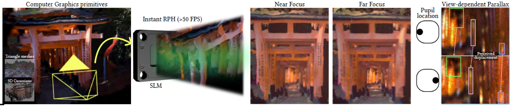

# Instant Random Phase Holography with Parallax and Defocus Cues

Oscar Pueyo-Ciutad, Victor Chu, Congli Wang, Ethan Tseng, Florian Schiffers, Albert Redo-Sanchez,
Diego Gutierrez, Felix Heide

**SIGGRAPH Asia 2026**

[Project page](https://opueyociutad.github.io/InstantRPH_Web/) |
[Data](https://nas-graphics.unizar.es/s/dSF7irgk9K6tB8e) |
[Paper](https://nas-graphics.unizar.es/s/InstantRPH_main) |
[Supplementary](https://nas-graphics.unizar.es/s/InstantRPH_supp)



Instant Random Phase Holography (Instant RPH) generates artifact-resilient holograms by
construction, encoding occlusion, view-dependent parallax and optical blur in a single forward
pass.

## Installation

```bash
git clone https://github.com/opueyociutad/InstantRPH.git
cd InstantRPH
uv sync
source .venv/bin/activate
```

`torch` wheels are CUDA-version specific. If the default PyPI wheel does not match your driver,
install the right build from [pytorch.org](https://pytorch.org/get-started/locally/) first and
then run `uv sync --no-install-package torch`. Without uv, `pip install -e .` installs the
dependencies listed in `pyproject.toml`. `ffmpeg` is only needed for the training-evolution
animations.

Run the commands from the repository root. Every script uses the GPU when one is visible (select
it with `CUDA_VISIBLE_DEVICES`) and the CPU otherwise.

---

## Data and paths

All inputs live in [`data/`](data/README.md) and everything the scripts write goes to
[`output/`](output/README.md). Each folder has a README describing its structure.

```
InstantRPH/
├── data/                        # inputs (see data/README.md)
│   ├── dataset_2d/              # DIV2K_train_HR/ (800 images), DIV2K_valid_HR/ (100 images)
│   ├── dataset_3d/              # MPI / focal-stack scene pairs (3D, not released yet)
│   ├── dataset_video/           # MPI video clips for render_video_3d.py
│   ├── models_2d/               # phase/l1_tmx24.pt, lae/<run>/ (pretrained 2D LAEs)
│   ├── models_3d/               # kernels/, phase/l21_tmx24.pt, lae/<run>/ (pretrained 3D LAEs)
│   ├── model_ARH/               # ARH baseline weights (3D runtime comparison only)
│   └── video_config/            # focus trajectories for render_video_3d.py
└── output/                      # results (see output/README.md)
    ├── 2d/                      # runs/, eval/, analysis/
    ├── 3d/                      # runs/, comparisons/, benchmark/
    ├── arh/                     # benchmark/
    └── video/
```

Git tracks only the READMEs, the propagation kernels and the video configs. Download or
generate the rest as follows.

Download the DIV2K dataset from source:
```bash
cd data/dataset_2d
wget https://data.vision.ee.ethz.ch/cvl/DIV2K/DIV2K_train_HR.zip
wget https://data.vision.ee.ethz.ch/cvl/DIV2K/DIV2K_valid_HR.zip
unzip DIV2K_train_HR.zip && unzip DIV2K_valid_HR.zip
cd ../..
```

Images are bilinearly resized on load to the SLM resolution (800 x 1280 by default).


To generate the random phase tensors use:
```bash
python generate_phase_pattern.py                                            # 3D: data/models_3d/phase/l21_tmx24.pt
python generate_phase_pattern.py --layers 1 --out-dir data/models_2d/phase  # 2D: data/models_2d/phase/l1_tmx24.pt
```

These hold i.i.d. uniform phases in `[0, 2π)` with shape `[LAYERS, TMX, RGB, H, W]`. The default
seed gives the exact tensors used in the paper.


The evaluation, benchmark and video launchers default to pretrained LAEs in
`data/models_2d/lae/` and `data/models_3d/lae/`. These are run folders with `config.json` and
`best.pt`, e.g. `lae_2d_tmx8_100.0mm/` and `lae_3d_tmx8_rgb/`. To evaluate your own run instead,
point them to its folder under `output/` (`RUN=output/2d/runs/<run>`), or copy that folder into
`data/models_*/lae/`.

### Configuration

Every setting is a command-line flag (`python <script>.py --help` lists them with their defaults). Each run stores its flags in `<output-dir>/config.json`, which is also embedded in its checkpoints, and evaluation scripts read the optics from there.

The physical constants (pixel pitch 10.8 µm, wavelengths 660/520/450 nm, SLM resolution) are
in [instantrph/constants.py](instantrph/constants.py). Focus trajectories for 3D video
rendering are YAML files in [data/video_config/](data/video_config/).

---

## 2D hologram generation and LAE training

[train_2d.py](train_2d.py) trains the LAE on DIV2K.

The **baseline** in all logs and metrics, labeled `dummy` / `ad_baseline`, is the same pipeline
with the identity encoder, i.e. plain amplitude-discarding random-phase holography.

The paper configuration for `tmx = 8` at 100 mm:

```bash
python train_2d.py \
    --tmx 8 --target-distance-mm 100.0 --layer-id 0 \
    --lr 1e-2 --epochs 100 --batch-size 6 \
    --tensorboard --val-every 1 --log-every 0 \
    --output-dir output/2d/runs/lae_2d_tmx8_100.0mm
```


### Run outputs

Each run is a folder under `output/2d/runs/` (see [output/README.md](output/README.md)):

```
<output-dir>/
├── config.json          # every flag of the run
├── best.pt / last.pt    # checkpoints (best = lowest validation loss)
├── sweep_metrics.json   # best val PSNR, baseline PSNR, PSNR gain, best epoch
├── tensorboard/         # with --tensorboard
└── viz_snapshots/       # with --viz-every-steps > 0
```

---

## Monitoring training: TensorBoard and metric evolution

Use tensorboard to monitor the training runs:
```bash
tensorboard --logdir output/2d/runs/                         # compare all runs (e.g. the tmx sweep)
```

[analysis/visualize_lae_evolution.py](analysis/visualize_lae_evolution.py) turns the snapshots
into animations. To train and animate the first 30 steps at `tmx = 8`:

```bash
bash analysis/train_lae_evolution_viz.sh
```

This writes `hologram_XX_evolution.mp4`, `psnr_evolution.mp4`, and
`lae_{scale,bias}_repeatXX_evolution.mp4` to `output/2d/analysis/lae_evolution_viz/viz_snapshots/`
(requires `ffmpeg`).

To render the LAEs of a trained checkpoint as PNGs (per channel, per
frame in RGB, and frame-averaged) in `output/2d/analysis/lae_params/<run>/`:

```bash
python analysis/visualize_lae_params.py --run-dir data/models_2d/lae/lae_2d_tmx8_100.0mm --save-individual
```

---

## Evaluation

[eval_2d.py](eval_2d.py) runs a trained LAE over the full DIV2K validation split
(100 images). It saves every reconstruction and per-image PSNR / SSIM for both the LAE and the
amplitude-discarding baseline.

```bash
python eval_2d.py --checkpoint data/models_2d/lae/lae_2d_tmx8_100.0mm/best.pt --batch-size 6
```

Results go to `output/2d/eval/<run>/` (or `--output-dir`).

```
output/2d/eval/<run>/
├── images/
│   ├── 000000_input.png
│   ├── 000000_pred_ours.png          # LAE reconstruction
│   ├── 000000_pred_ad_baseline.png   # amplitude-discarding baseline
│   └── 000000_target.png
└── metrics.csv                       # sample_idx, psnr_ad_baseline, ssim_ad_baseline, psnr_ours, ssim_ours
```


## 3D holography

In 3D, the LAE encodes a multi-plane image (MPI). Instant RPH ([instantrph/renderer_3d.py](instantrph/renderer_3d.py)) pairs each
layer with its own random phase and composites the layers from back to front with
occlusion-aware blending. Between layers it propagates with precomputed compact
Rayleigh–Sommerfeld kernels ([data/models_3d/kernels/](data/models_3d/kernels/README.md)). It then propagates to the SLM and
discards the amplitude. Training renders the hologram at every plane of a target focal stack and minimizes the color-balanced L1 loss.

### 3D data

`--data-root` (default `data/dataset_3d`) holds one MPI / focal-stack pair per scene:

- `diopter_mpi_dataset/<scene>/` and `focal_mpi_dataset/<scene>/`, each a folder of images (MPI: one RGBA image per layer, focal stack: one image per focus plane)

MPI colors are intensities (square-rooted on load; use `--input-is-amplitude` otherwise). The focus planes are a linear sweep from `--focus-start-mm` to `--focus-end-mm` (or
`--focus-distances-mm`).

### Training

To save memory, each wavelength is trained in its own run with
[accelerate](https://huggingface.co/docs/accelerate) on multiple GPUs. The three runs are then merged into one RGB model, `output/3d/runs/lae_3d_tmx8_rgb`:

```bash
bash scripts/train_3d_rgb.sh          # WAVELENGTH=r, g, b runs of scripts/train_3d.sh, then the merge
```

The wavelengths can also train in parallel, e.g. on separate nodes: run
`WAVELENGTH=r bash scripts/train_3d.sh` once per wavelength, then
`TMX=8 bash scripts/merge_rgb_3d.sh` (`output/3d/runs/lae_3d_tmx8_{r,g,b}` -> `output/3d/runs/lae_3d_tmx8_rgb`).
One wavelength without the launcher:

```bash
accelerate launch --multi_gpu --num_processes 4 train_3d.py --use-accelerate \
    --data-root data/dataset_3d --train-wavelength r --tmx 8 --epochs 1000 --batch-size 5 --lr 1e-2 \
    --val-fraction 0.05 --focus-start-mm 97.75 --focus-end-mm 100.0 --enable-augmentation \
    --tensorboard --output-dir output/3d/runs/lae_3d_tmx8_r
```

Without `--use-accelerate`, `train_3d.py` trains on a single device. TensorBoard logs
`loss/train`, `psnr/train`, `loss/val`, `psnr/val`, `optimizer/lr`,
`memory/max_allocated_mb`, and `visuals/target_then_prediction`, which shows target and predicted focus planes, labeled with their distance. Runs store `config.json`,
`best.pt` and `last.pt`.

### Evaluation and inference on example scenes

```bash
python eval_3d.py --run-dir data/models_3d/lae/lae_3d_tmx8_rgb --save-phase-patterns \
    --export-dir output/3d/comparisons/lae_3d_tmx8_rgb/export
```

This prints the focal-stack L1 loss and PSNR of Instant RPH and of the amplitude-discarding
baseline. It writes to `output/3d/comparisons/<run>/` (or `--output-dir`).


`bash scripts/eval_3d.sh` runs the evaluation with the phase patterns enabled, on the pretrained LAE by default (`RUN=output/3d/runs/<run>` for your own).

### Comparison with ARH

[eval_3d_arh.py](eval_3d_arh.py) evaluates the ARH baseline
([instantrph/arh.py](instantrph/arh.py), weights in `data/model_ARH/`, see its
[README](data/model_ARH/README.md)). It uses the same configuration: same scenes,
focus planes, SLM distance, layer spacing and color-balanced metric.


### Runtime

[benchmark_3d.py](benchmark_3d.py) times hologram generation and the ARH baseline:

```bash
python benchmark_3d.py --method instantrph --run-dir data/models_3d/lae/lae_3d_tmx24_rgb --tmx 24 --optimize --use-autocast
python benchmark_3d.py --method arh --mpi-dir <rgba-layer-pngs> --tmx 8
```

---

## Citation

```bibtex
@inproceedings{pueyociutad2026instantrph,
    title     = {Instant Random Phase Holography with Parallax and Defocus Cues},
    author    = {Pueyo-Ciutad, Oscar and Chu, Victor and Wang, Congli and Tseng, Ethan and Schiffers, Florian and Redo-Sanchez, Albert and Gutierrez, Diego and Heide, Felix},
    booktitle = {SIGGRAPH Asia 2026 Conference Papers},
    month     = {December},
    year      = {2026}
}
```
## Contact

Feel free to open an issue or email o.pueyo@unizar.es / opueyociutad@gmail.com (please cc both) for any question.

## License

Released under [CC BY-NC 4.0](https://creativecommons.org/licenses/by-nc/4.0/) (non-commercial
use only); see [LICENSE](LICENSE).
